# 核心语法

## ⁠1 ⁠变量与条件循环


1. JavaScript 语句以分号 `;` 结束，虽然可选，建议加上。
2. 注释

```JavaScript
// this is a single-line comment

/* This is a block comment
that can span multiple lines */
```

### ⁠1.1 ⁠变量声明

```JavaScript
// 推荐写法（ES6+）
let age = 25;           // 可变变量
const PI = 3.14;        // 常量（优先使用）
let name = "张三";

// 旧写法（尽量少用）
var oldVar = "不推荐";
```

**和 Java 的对比**：
- let ≈ Java 的局部变量
- const ≈ final（但对象内容仍可变）
- 没有类型声明，类型是运行时决定的（动态类型）
- var 有函数作用域和变量提升问题，现代代码几乎不用

### ⁠1.2 ⁠基本数据类型

```javaScript
// 原始类型（Primitive）
let str = "hello";          // 字符串
let num = 42;               // 数字（没有 int/float 区分，都是 Number）
let bool = true;            // 布尔
let empty = null;           // 空值
let notDefined = undefined; // 未定义
let big = 123n;             // BigInt（很大的整数）
let unique = Symbol("id");  // 符号（唯一值）

// 引用(对象)类型
let obj = { name: "张三", age: 25 };  // 对象
let arr = [1, 2, 3];                  // 数组（本质也是对象）
let func = function() {};             // 函数（一等公民）
```


类型判断
```javaScript
typeof 42;          // "number"
typeof "hi";        // "string"
typeof true;        // "boolean"
typeof undefined;   // "undefined"
typeof null;        // "object"（历史遗留坑）
typeof {};          // "object"
Array.isArray([]);  // true
```


### ⁠1.3 ⁠运算符

```javaScript
// 算术
+ - * / % **（幂运算）

// 比较
===  !==   // 严格相等（推荐，同时比较值和类型）
==   !=    // 宽松相等（会做类型转换，容易出坑）

1 == "1"    // true（宽松）
1 === "1"   // false（严格，推荐永远用 ===）
0 || "默认" // "默认"
null ?? "默认" // "默认"

// 逻辑
&&  ||  !  

// 其他
??          // 空值合并（null 或 undefined 时取右边）
?.          // 可选链（安全访问属性）
```

### ⁠1.4 ⁠条件与循环

```javaScript
// if
if (age >= 18) {
  console.log("成年");
} else if (age >= 12) {
  console.log("青少年");
} else {
  console.log("儿童");
}

// 三元
let status = age >= 18 ? "成年" : "未成年";

// switch（和 Java 类似，但用 === 比较）
switch (fruit) {
  case "apple":
    console.log("苹果");
    break;
  default:
    console.log("其他");
}

// 循环
for (let i = 0; i < 5; i++) { ... }

while (condition) { ... }

// 数组遍历（更常用）
for (const item of arr) { ... }          // 值
for (const key in obj) { ... }           // 键（对象用）
arr.forEach(item => { ... });
```

### ⁠1.5 ⁠字符串

- 字符串是零个或多个字符的序列。
- 字符串文字以单引号 (') 或双引号 (") 开始和结束
- JavaScript 字符串是不可变的，这意味着它们在创建后修改将返回新的对象。

```javaScript
// 1. 双引号
let s1 = "Hello";
// 2. 单引号
let s2 = 'Hello';
// 3. 反引号（模板字符串，推荐）
let s3 = `Hello`;

let str = "Hello";
console.log(str.length);     // 5（字符个数）
console.log(str[0]);         // "H"（推荐写法）

```

**使用模板字符串拼接**

```javaScript
const name = "张三";
const age = 28;

// 传统写法（拼接很麻烦）
const str1 = "我叫" + name + "，今年" + age + "岁。";
// 模板字符串写法
const str2 = `我叫${name}，今年${age}岁。`;
console.log(str2); // 我叫张三，今年28岁。


// 传统写法需要 \n 或字符串拼接，模板字符串天然支持换行

// 传统写法
const html1 = "<div>\n" +
              "  <h1>标题</h1>\n" +
              "  <p>内容</p>\n" +
              "</div>";

// 模板字符串
const html2 = `
<div>
  <h1>标题</h1>
  <p>内容</p>
</div>
`;

console.log(html2);
```

**核心规则**：
- 使用反引号 ` 包裹
- 用 ${表达式} 插入变量或表达式
- ${} 里面可以写任意合法的 JavaScript 表达式


## ⁠2 ⁠解构、展开、剩余参数
### ⁠2.1 ⁠解构
解构（Destructuring） 是 ES6 引入的语法，方便地从数组或对象中提取值，并赋值给变量。
```javaScript
const arr = ["admin", "user"];
const [first, second] = arr;                 // 数组解构


const result = useState(0);  // result 是个数组，比如 [0, 函数]
const state = result[0];     // 第 0 格：当前值
const setState = result[1];  // 第 1 格：修改函数

const product = { name: "键盘", price: 399 };
const { name, price } = product;             // 对象解构：变量名和字段名一致
const { name: n } = product;                 // 改名：取 name 存到变量 n
const { stock = 0 } = product;               // 默认值：没有这个字段就给兜底
```

**从函数返回多个值**：
```js
function getUser() {
  return { id: 1, name: '赵六', role: 'admin' };
}
const { name, role } = getUser();
```

**配合 API 数据**：
```js
const response = {
  data: {
    user: { name: '小明', age: 20 },
    token: 'abc123'
  }
};

const {
  data: {
    user: { name },
    token
  }
} = response;
```

**在循环中使用**：
```js
const users = [
  { id: 1, name: 'A' },
  { id: 2, name: 'B' }
];

for (const { id, name } of users) {
  console.log(id, name);
}
```


### ⁠2.2 ⁠展开运算符

JavaScript 中的 展开运算符（Spread Operator）是三个点 `...`，它可以将一个可迭代对象（如数组、字符串）或对象字面量"展开"为多个元素。常用于浅拷贝得到新的对象。


 1. 数组拷贝
```javascript
// 合并2个数组
const arr1 = [1, 2];
const arr2 = [3, 4];
const merged = [...arr1, ...arr2]; // [1, 2, 3, 4]

// 拷贝数组
const original = [1, 2, 3];
const copy = [...original]; // [1, 2, 3]
copy.push(4);
console.log(original); // [1, 2, 3] — 原数组不受影响

// 在数组中间插入值
const nums = [2, 3];
const withInsert = [1, ...nums, 4]; // [1, 2, 3, 4]
```


 1. 对象属性拷贝
```javascript
const obj1 = { a: 1, b: 2 };
const obj2 = { c: 3 };
const merged = { ...obj1, ...obj2 }; // { a: 1, b: 2, c: 3 }

// 先浅拷贝，再覆盖/添加属性：后面的同名属性会覆盖前面的
const user = { name: "Tom", age: 20 };
const updated = { ...user, age: 21, city: "Beijing" };
```


### ⁠2.3 ⁠剩余参数

剩余参数（Rest Parameters）是 ES6 引入的语法，用 `...` 把函数的“剩余”参数收集成一个真正的数组。

```js
function 函数名(普通参数, ...剩余参数) {
  // 剩余参数是一个数组
}

function introduce(name, age, ...hobbies) {
  console.log(`${name}，${age}岁`);
  console.log('爱好：', hobbies);
}

introduce('小明', 18, '篮球', '编程', '游泳');
// 小明，18岁
// 爱好： ['篮球', '编程', '游泳']
```

- `...` 只能写在**参数列表的最后一位**。
- 它会把从当前位置开始的所有实参收集成一个**数组**。
- 如果没有多余参数，得到的是空数组 `[]`。


## ⁠3 ⁠数组

JavaScript 的数组（Array）是有序的、可变的集合，可以存放任意类型的值（包括对象、函数、甚至另一个数组）。数组是对象的一种特殊形式，索引从 0 开始，并拥有 length 属性。

对于数组中的方法需要关注是否会改变原数组：
1. `map` / `filter` / `reduce` / `find` **不修改原数组**，返回新值 → 不可变风格；
2. `sort` **会修改原数组** → 先 `[...arr].sort(...)` 复制再排；
3. `map` 里要做多件事就**显式 return**：`arr.map((x) => { return ...; })`，否则拿到一堆 `undefined`（常见坑）。

|方法|作用|Java 对照|例|
|---|---|---|---|
|`map`|一对一转换，返回**新数组**|`Stream.map`|提取名称、加税|
|`filter`|筛选，返回**新数组**|`Stream.filter`|有货的|
|`find`|取第一个匹配项（无则 `undefined`）|`findFirst().orElse(null)`|找键盘|
|`reduce`|汇总成单个值|`Stream.reduce`|总价|
|`sort`|排序（⚠️ 改原数组，先复制）|`sorted()`|按价格|
|`forEach`|遍历|`for-each`|打印|

链式组合，和Java中的Steam一样
```js
const onSaleTotal = products
  .filter((p) => p.stock > 0)      // 筛选
  .map((p) => p.price * 0.9)       // 转换
  .reduce((sum, v) => sum + v, 0); // 汇总
```


### ⁠3.1 ⁠基础操作

1. 创建数组

```javascript
// 字面量（最常用）
const arr1 = [1, 2, 3];
const arr2 = ['a', true, { name: 'Grok' }, [4, 5]];

// 构造函数
const arr3 = new Array(1, 2, 3);          // [1, 2, 3]
const arr4 = new Array(5);                // 长度为 5 的空数组（稀疏数组）
const arr5 = Array.of(1, 2, 3);           // [1, 2, 3]（推荐，避免 new Array(5) 的歧义）
const arr6 = Array.from('hello');         // ['h','e','l','l','o']
const arr7 = Array.from({ length: 5 }, (_, i) => i * 2); // [0, 2, 4, 6, 8]
```

 2. 访问与修改元素

```javascript
const arr = ['a', 'b', 'c'];

arr[0];        // 'a'
arr[1] = 'x';  // ['a', 'x', 'c']

// 越界访问返回 undefined
arr[10];       // undefined

// 数组长度
arr.length;    // 3
arr.length = 2; // 截断为 ['a', 'x']（会删除末尾元素！）
```

3. 判断数组

```javascript
Array.isArray([]);        // true
Array.isArray({});        // false
Array.isArray(null);      // false
```


4. 增删元素

这些方法会**直接修改原数组**：

| 方法                                     | 作用      | 返回值      |
| -------------------------------------- | ------- | -------- |
| `push(...items)`                       | 末尾添加    | 新数组长度    |
| `pop()`                                | 末尾移除    | 被移除的元素   |
| `shift()`                              | 开头移除    | 被移除的元素   |
| `unshift(...items)`                    | 开头添加    | 新数组长度    |
| `splice(start, deleteCount, ...items)` | 任意位置增删改 | 被删除的元素数组 |

```javascript
const arr = [1, 2, 3];

arr.push(4, 5);       // [1,2,3,4,5]，返回 5
arr.pop();            // [1,2,3,4]，返回 5
arr.unshift(0);       // [0,1,2,3,4]，返回 5
arr.shift();          // [1,2,3,4]，返回 0

// splice：从索引1开始，删除1个，插入'a','b'
const removed = arr.splice(1, 1, 'a', 'b');
// arr: [1, 'a', 'b', 3, 4]
// removed: [2]
```


### ⁠3.2 ⁠常用方法


## ⁠4 ⁠对象


this指向问题，而Java就没有

在JavaScript中，除了原始类型，其它一些皆是对象，对象本质是 属性的集合，对应的键是字符串类型，而值可以是任意数据类型。

```javaScript
// 一个简单的对象
const person = {
  name: "张三",
  age: 28,
  isStudent: false
};
```


### ⁠4.1 ⁠对象的创建

方式一：对象字面量（最常用）

```javaScript
const user = {
  name: "李四",
  age: 30,
  sayHi() {                  // 方法简写（推荐）
    console.log("你好");
  }
};
```

方式二：new Object()

```javaScript
const user = new Object();
user.name = "李四";
user.age = 30;
```

方式三：Object.create()

```javaScript
const proto = { hello() { console.log("hello"); } };
const obj = Object.create(proto);  // 指定原型
```


### ⁠4.2 ⁠属性操作

```javaScript
const person = {
  name: "张三"
};

// 增加 / 修改属性
person.age = 28;               // 点语法
person["gender"] = "男";       // 方括号语法（属性名是变量或特殊字符时用）

// 查询
console.log(person.name);      // "张三"
console.log(person["age"]);    // 28

// 删除属性
delete person.gender;

// 检查属性是否存在
"name" in person;              // true
person.hasOwnProperty("name"); // true（只检查自身，不检查原型）
```


方括号语法的重要用途：
```javaScript
const key = "age";
person[key] = 30;              // 等价于 person.age = 30
```


遍历对象的属性

```js
const person = {
  name: "张三",
  age: 28,
  gender: "男"
};

// 1. for...in（会遍历原型链上的可枚举属性）
for (const key in person) {
  console.log(key, person[key]);
}

// 2. Object.keys()（只返回自身可枚举属性名）
Object.keys(person);        // ["name", "age", "gender"]

// 3. Object.values()
Object.values(person);      // ["张三", 28, "男"]

// 4. Object.entries()（最常用）
Object.entries(person);     // [["name","张三"], ["age",28], ["gender","男"]]

// 结合解构
for (const [key, value] of Object.entries(person)) {
  console.log(key, value);
}
```
### ⁠4.3 ⁠方法操作

对象中属性值的类型是函数，称之为方法，

```javaScript
const person = {
  name: "张三",
  age: 28,

  // 方法
  introduce() {
    console.log(`我叫${this.name}，今年${this.age}岁`);
  },

  // 也可以这样写
  growOlder: function() {
    this.age++;
  }
};

person.introduce();  // 我叫张三，今年28岁
person.growOlder();
```

在对象方法中，this 指向调用该方法的对象。
```javaScript
const person = {
  name: "张三",
  sayName() {
    console.log(this.name);
  }
};

person.sayName();     // "张三"   ← this 指向 person
```


```javaScript
const fn = person.sayName;
fn();                 // undefined（严格模式下报错）← this 丢失
```

# 函数
1. 函数就是**普通的值**（一等公民）。你**可以在任何作用域里声明**函数，包括：全局、另一个函数内部、箭头函数、普通函数、对象方法……都可以。**可以赋值**给变量、作为参数传递、作为返回值返回、动态创建。
2. 函数也是对象：拥有属性和方法（如 `length`、`name`、`call`、`apply`、`bind`）。
3. 执行函数时，会创建一个**执行上下文**（Execution Context），包含变量环境、词法环境、`this` 绑定等。  
>核心心法：函数就是在内存中的某段代码，只要拿到这段代码在内存中的地址，就可以进行执行，在JS中通过对象的形式来指向这个函数，内部通过this符号来指向该函数被执行时所处的上下文对象。

## ⁠1 ⁠定义函数

### ⁠1.1 ⁠函数声明
```js
function add(a, b) {
  return a + b;
}
```
- 特点：**会被提升（hoisting）**。也即在它前面的代码块里也可以访问，整个函数体在作用域内提前可用。
- 适合需要在定义前调用的场景。

### ⁠1.2 ⁠函数表达式
```js
const add = function(a, b) {
  return a + b;
};
```
- 特点：不会被提升（变量提升，但赋值为 `undefined`）。
- 可以是匿名的，也可以命名（命名便于调试和递归）。

### ⁠1.3 ⁠箭头函数
```js
const add = (a, b) => a + b;          // 单行隐式返回
const add = (a, b) => { return a + b; }; // 多行
const square = x => x * x;            // 单参数可省略括号
```
- **没有自己的 `this`、`arguments`、`super`、`new.target`**。
- `this` 继承自外层词法作用域（非常适合回调）。
- 不能作为构造函数（不能用 `new`）。
- 更简洁，推荐在现代代码中优先使用。

### ⁠1.4 ⁠其他方式
- **方法简写**（对象字面量）：
  ```js
  const obj = {
    add(a, b) { return a + b; }
  };
  ```
- **Function 构造函数**（不推荐，有作用域和性能问题）：
  ```js
  const add = new Function('a', 'b', 'return a + b');
  ```
- **立即执行函数表达式（IIFE）**：
  ```js
  (function() {
    // 私有作用域
  })();
  ```

## ⁠2 ⁠参数与返回值

在JavaScript中调用函数参数的传递直接按照顺序传递即可，不像Python那样搞那么多花样。JavaScript和java一样，参数是按照值来传递，对于基本数据类型，就是值本身，对于引用对象，就是对象的引用值。
>JavaScript中允许传入任意个参数而不影响调用，传入的参数比定义的参数少或者多都不会影响调用

### ⁠2.1 ⁠参数
- 形参可以有默认值（ES6）：
  ```js
  function greet(name = 'Guest') { ... }
  ```
- 剩余参数（Rest）：
  ```js
  function sum(...nums) { return nums.reduce((a, b) => a + b, 0); }
  ```
- 解构参数：
  ```js
  function print({ name, age }) { ... }
  ```
- `arguments` 对象（类数组）：在普通函数中可用，箭头函数中没有。推荐用 Rest 参数替代。

### ⁠2.2 ⁠返回值
- 使用 `return`。没有 `return` 或 `return;` 则返回 `undefined`。
- 可以返回任何类型，包括函数（高阶函数）。

## ⁠3 ⁠闭包

函数可以“记住”并访问其定义时的词法环境。内层函数可以访问外层函数定义的所有变量和函数，并且只要这个内层函数一直存在，被它访问的外层变量和函数就不会被销毁，内层函数会一直持有它们的引用。

**闭包背后设计基本原理：**
1、是在JS和Python中，函数中声明的变量并不会直接放在调用栈里，而是放在一个叫**词法环境的数据结构对象中，被存储在内存堆**中（保证函数执行结束后变量可以被垃圾回收器进行分析而不是随着调用栈的销毁而销毁）。在函数执行时，**这个词法环境结构对象被创建，其内部函数本身会自动引用外部函数的词法环境对象（在 JS 规范中叫 [[Environment]]，Python 中叫 closure）**，在外部函数执行完毕后，垃圾回收器开始分析，基本原理就是可达性分析，分析该词法环境对象哪些变量依然被外部变量引用，所以如果当初的内部函数被返回到外部被某个变量接收了，那么该内部函数对象就是存活着，如果正好该内部函数引用了当初外部函数的的某些变量，那么这些内部变量则不会被销毁，继续保留在内存堆中。
2、当内部函数被执行时，如果代码中出现对外部变量的访问（比如执行 `count++` 或 `obj.name = 'test'`），引擎并不是在栈上重新创建一个指向堆对象的局部变量，而是进行**标识符解析（Identifier Resolution）**：、
- 引擎先在内部函数的局部栈帧里找 `count`，没找到。
- 引擎顺着内部函数身上的隐藏指针 `[[Environment]]`，直接摸到了堆内存中那个幸存的**外部词法环境对象**。
- 引擎在这个堆对象里找到了 `count` 的槽位，并直接在这个槽位上进行读取或修改。
3、当内部函数执行结束，它的调用栈帧被销毁，它自己内部的局部变量确实随之灰飞烟灭了。但是，那个被它在堆内存中跨域修改的外部变量（如 `count` 变成了 `1`）依然完好无损地躺在堆内存的词法环境对象里。 等到内部函数**下一次**被执行时，它顺着指针再次找到这个槽位，读取到的就是上一次修改后的值（`1`）

```mermaid
graph TD
    subgraph CallStack["调用栈 (Call Stack)"]
        EC_Ext["外部函数执行上下文<br/>(External Execution Context)<br/>执行完毕即弹出销毁"]
        EC_Int["内部函数执行上下文<br/>(Internal Execution Context)<br/>未来每次调用时创建，执行完销毁"]
    end

    subgraph HeapMemory["内存堆 (Heap Memory)"]
        LexEnv["外部函数词法环境对象<br/>(Lexical Environment)<br/>因被引用而驻留内存"]
        Slot1["被捕获变量槽位<br/>(例: count = 1)"]
        Slot2["被捕获变量槽位<br/>(例: obj = {...})"]
        IntFuncObj["内部函数对象<br/>(Function Object)<br/>被外部变量接收，持续存活"]
    end

    %% 外部函数的作用
    EC_Ext -. "1. 产生变量并触发逃逸分析" .-> LexEnv
    EC_Ext -. "2. 创建内部函数" .-> IntFuncObj

    %% 词法环境内部结构
    LexEnv --- Slot1
    LexEnv --- Slot2

    %% 核心：闭包的引用链
    IntFuncObj == "3. &#91;&#91;Environment&#93;&#93; 隐藏指针<br/>(锁定词法环境，阻止GC回收)" ==> LexEnv

    %% 内部函数执行时的寻址
    EC_Int -- "4. 标识符跨域寻址/读写" --> Slot1
    EC_Int -- "4. 标识符跨域寻址/读写" --> Slot2

    classDef stack fill:#f9d0c4,stroke:#333,stroke-width:2px;
    classDef heap fill:#d4e6f1,stroke:#333,stroke-width:2px;
    classDef core fill:#fcf3cf,stroke:#f39c12,stroke-width:3px;

    class EC_Ext,EC_Int stack;
    class LexEnv,Slot1,Slot2,IntFuncObj heap;
    class IntFuncObj core;
```





  ```js 
  function createCounter() {  
    let count = 0;  
    return ()=>++count;  
}  
// 内部函数被创建返回，函数自身挂载的Environment指针指向外部函数的词法环境对象  
const counter = createCounter();  
 
console.log(counter()); // 1  
console.log(counter()); // 2
  ```


## ⁠4 ⁠this

Java Script一开始只有普通函数，内部的this也即普通函数每次执行时，自动给this进行重新绑定，由调用方式决定，而箭头函数没有自己的this，它内部的this被当作变量使用，基于闭包进行运作，也即外部函数在执行，该箭头函数被创建时，基于闭包的方式，该this就指向了外部函数this对应的对象，后续该箭头函数被重新执行，不管被放在哪个外部函数中执行，this的指向都不变了。


 Java中的this：在编译期间就确定了，this永远指向当前实例，即使在内部类，也是指向内部类实例本身，且Java中提供OuterClass.this.field的方式用于在内部类中访问外部类实例的成员（因为Java中以规定现有外部类实例，后有内部类实例）。
> 为什么Java可以直接在编译期间确定this指向？因为在Java中，函数不能单独存在，必须依赖于对象进行调用。

而在JavaScript中，函数既可以直接调用，也可以通过对象去调用，所以javaScript中的函数的this指向无法在编译器期间直接确定。

```java
public class ButtonClickDemo {
    private String label = "主窗口";

    public void init() {
        JButton button = new JButton("点击我");

        // 注册点击监听器（回调）
        button.addActionListener(new ActionListener() {
            @Override
            public void actionPerformed(ActionEvent e) {
                // 在回调中直接访问外部类的字段 —— 编译器自动处理
                System.out.println("按钮被点击，当前窗口: " + label);
                
                // 等价于：
                System.out.println("按钮被点击，当前窗口: " + ButtonClickDemo.this.label);
            }
        });
    }
}
```


javaScript中，由于它是动态解释型语言，this是在运行过程中根据调用方式指定的：
- 如果是对象调用，则方法中的this指向对象本身，
- 如果是普通函数调用，在非严格模式下，this指向全局对象，严格模式下，undefind
- 而如果是箭头函数，没有自己的 this，它会继承外层作用域的 this（定义时就确定了），在被当作回调函数时大量使用，因为传入回调函数时，会被接收方使用一个变量接收，然后再进行调用，所以会被当作一个普通函数调用最终，

## ⁠5 ⁠用 new 调用构造函数时，this 指向新创建的对象。

```javaScript
function Person(name) {
  this.name = name;
  this.sayHi = function() {
    console.log(`你好，我是${this.name}`);
  };
}

const p = new Person("张三");
p.sayHi();  // 你好，我是张三
```

## ⁠6 ⁠通过对象调用方法时，this 指向该对象。

```javaScript
const person = {
  name: "王五",
  sayName() {
    console.log(this.name);
  }
};

person.sayName();     // 王五   ← this 指向 person


```

## ⁠7 ⁠普通函数直接调用时

```javaScript
// 原因：fn 只是普通函数调用，不再通过对象调用,在严格模式下 this 丢失。
const fn = person.sayName;
fn();                 // undefined（严格模式下报错）

// 非严格模式下，- this 指向全局对象（浏览器是 window，Node 是 global）
```

## ⁠8 ⁠显示绑定this
手动指定 this 指向谁。

```javaScript
function greet() {
  console.log(`你好，我是${this.name}`);
}

const user = { name: "李四" };

// call 和 apply 立即执行
greet.call(user);     // 你好，我是李四
greet.apply(user);    // 你好，我是李四

// bind 返回一个新函数，this 被永久绑定
const fn = greet.bind(user);
fn();                 // 你好，我是李四
```

call 和 apply 的区别只在传参方式：
- call(thisArg, arg1, arg2, ...)
- apply(thisArg, [arg1, arg2, ...])

## ⁠9 ⁠箭头函数的特殊行为

箭头函数没有自己的 this，它会继承外层作用域的 this（定义时就确定了）。

```javaScript
const person = {
  name: "赵六",
  sayName: () => {
    console.log(this.name);  // 这里的 this 不是 person！
  },
  sayName2() {
    const fn = () => {
      console.log(this.name); // 继承 sayName2 的 this
    };
    fn();
  }
};

person.sayName();   // undefined（或报错）
person.sayName2();  // 赵六

```

箭头函数常用于回调，避免丢失this，简单来讲，如果想在一个函数的内部函数里访问外部函数所在作用域的this指向的对象，则需要使用箭头函数来完成。
```javaScript
const person = {
  name: "张三",
  hobbies: ["篮球", "游泳"],
  showHobbies() {
    this.hobbies.forEach(hobby => {
      console.log(`${this.name} 喜欢 ${hobby}`);
    });
  }
};

person.showHobbies();
// 张三 喜欢 篮球
// 张三 喜欢 游泳
```
# 原型


# 最佳实践与常见陷阱

**推荐**：
- 优先使用箭头函数 + `const`/`let`。
- 使用默认参数、Rest、解构。
- 小函数、单一职责。
- 合理使用闭包，避免内存泄漏（注意解除引用）。

**陷阱**：
- 普通函数中的 `this` 丢失（常见于事件回调、定时器）→ 用箭头或 `bind`。
- 闭包中循环变量问题（用 `let` 或 IIFE 解决）。
- 过度使用递归导致栈溢出。
- 把箭头函数当构造函数。
- 混淆提升行为。
