函数可以“记住”并访问其定义时的词法环境。内层函数可以访问外层函数定义的所有变量和函数，并且只要这个内层函数一直存在，被它访问的外层变量和函数就不会被销毁，内层函数会一直持有它们的引用。

**闭包背后设计基本原理：**
1、是在JS和Python中，函数中声明的变量并不会直接放在调用栈里，而是放在一个叫**词法环境的数据结构对象中，被存储在内存堆**中（保证函数执行结束后变量可以被垃圾回收器进行分析而不是随着调用栈的销毁而销毁）。在函数执行时，**这个词法环境结构对象被创建，其内部函数本身会自动引用外部函数的词法环境对象（在 JS 规范中叫 [[Environment]]，Python 中叫 closure）**，在外部函数执行完毕后，垃圾回收器开始分析，基本原理就是可达性分析，分析该词法环境对象哪些变量依然被外部变量引用，所以如果当初的内部函数被返回到外部被某个变量接收了，那么该内部函数对象就是存活着，如果正好该内部函数引用了当初外部函数的的某些变量，那么这些内部变量则不会被销毁，继续保留在内存堆中。

2、当内部函数被执行时，如果代码中出现对外部变量的访问（比如执行 `count++` 或 `obj.name = 'test'`），引擎并不是在栈上重新创建一个指向堆对象的局部变量，而是进行**标识符解析（Identifier Resolution）**：、
- 引擎先在内部函数的局部栈帧里找 `count`，没找到。
- 引擎顺着内部函数身上的隐藏指针 `[[Environment]]`，直接摸到了堆内存中那个幸存的**外部词法环境对象**。
- 引擎在这个堆对象里找到了 `count` 的槽位，并直接在这个槽位上进行读取或修改。

3、当内部函数执行结束，它的调用栈帧被销毁，它自己内部的局部变量确实随之灰飞烟灭了。但是，那个被它在堆内存中跨域修改的外部变量（如 `count` 变成了 `1`）依然完好无损地躺在堆内存的词法环境对象里。 等到内部函数**下一次**被执行时，它顺着指针再次找到这个槽位，读取到的就是上一次修改后的值（`1`）

```mermaid
graph TD
    subgraph CallStack["调用栈 (Call Stack)"]
        EC_Ext["外部函数执行上下文<br/>(External Execution Context)<br/>执行完毕即弹出销毁"]
        EC_Int["内部函数执行上下文<br/>(Internal Execution Context)<br/>未来每次调用时创建，执行完销毁"]
    end

    subgraph HeapMemory["内存堆 (Heap Memory)"]
        LexEnv["外部函数词法环境对象<br/>(Lexical Environment)<br/>因被引用而驻留内存"]
        Slot1["被捕获变量槽位<br/>(例: count = 1)"]
        Slot2["被捕获变量槽位<br/>(例: obj = {...})"]
        IntFuncObj["内部函数对象<br/>(Function Object)<br/>被外部变量接收，持续存活"]
    end

    %% 外部函数的作用
    EC_Ext -. "1. 产生变量并触发逃逸分析" .-> LexEnv
    EC_Ext -. "2. 创建内部函数" .-> IntFuncObj

    %% 词法环境内部结构
    LexEnv --- Slot1
    LexEnv --- Slot2

    %% 核心：闭包的引用链
    IntFuncObj == "3. &#91;&#91;Environment&#93;&#93; 隐藏指针<br/>(锁定词法环境，阻止GC回收)" ==> LexEnv

    %% 内部函数执行时的寻址
    EC_Int -- "4. 标识符跨域寻址/读写" --> Slot1
    EC_Int -- "4. 标识符跨域寻址/读写" --> Slot2

    classDef stack fill:#f9d0c4,stroke:#333,stroke-width:2px;
    classDef heap fill:#d4e6f1,stroke:#333,stroke-width:2px;
    classDef core fill:#fcf3cf,stroke:#f39c12,stroke-width:3px;

    class EC_Ext,EC_Int stack;
    class LexEnv,Slot1,Slot2,IntFuncObj heap;
    class IntFuncObj core;
```

